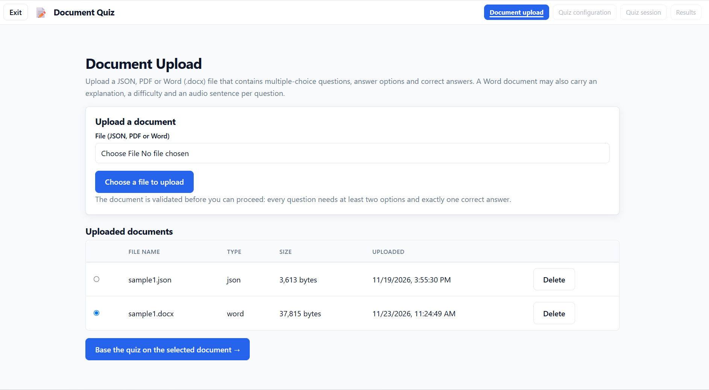
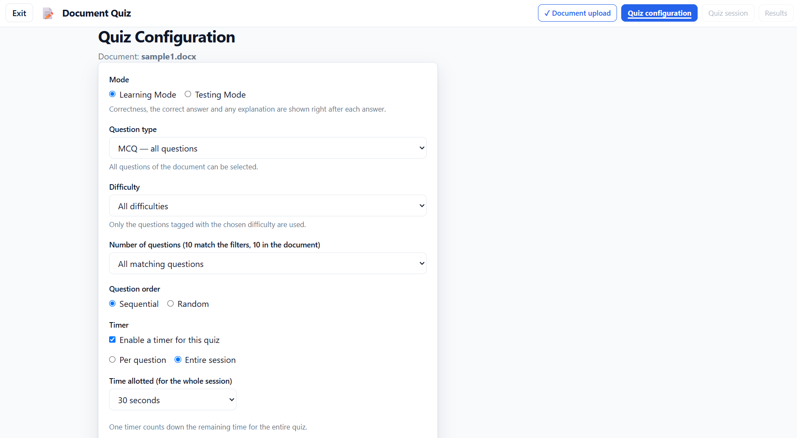
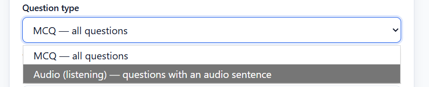
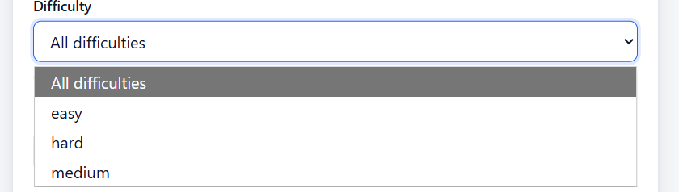
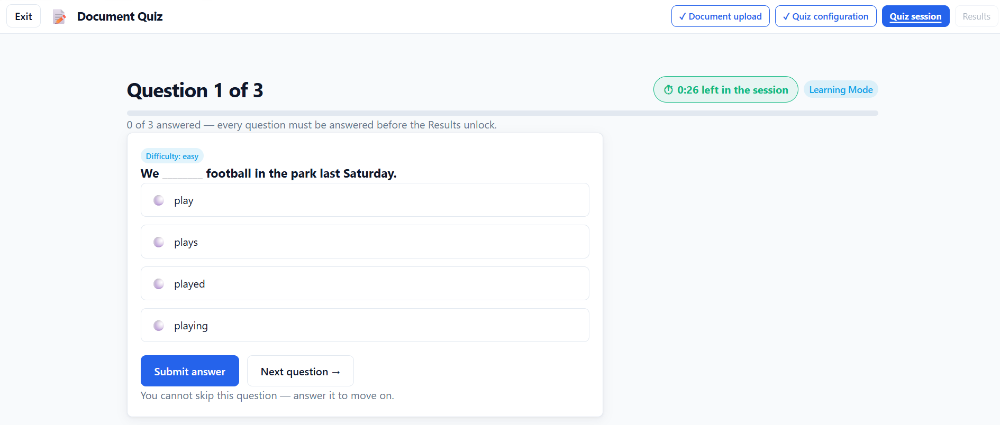
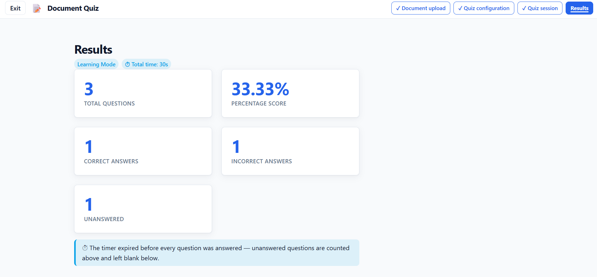
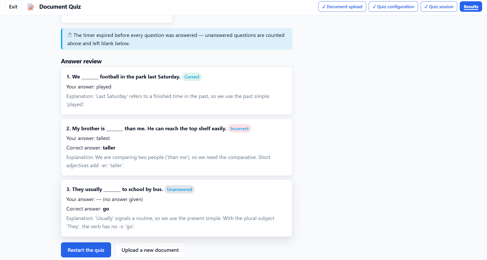

# FOQUS - Free and Open QUiz System

FOQUS turns an uploaded file of multiple-choice questions into an interactive quiz. You upload a JSON, Word (`.docx`) or PDF file, configure the quiz (mode, question type, difficulty, order, timer), answer the questions one at a time, and get a scored result with an answer review.

The app has **four screens**, shown as a step bar at the top of every page:

**Document upload → Quiz configuration → Quiz session → Results**

Two ready-made example files are included in the repository root: [`sample1.json`](sample1.json) and [`sample1.docx`](sample1.docx) (10 English A2 questions with explanations, difficulty levels and four audio sentences).

## Contents

- [Top bar: step bar and Exit button](#top-bar-step-bar-and-exit-button)
- [1. Document upload](#1-document-upload)
- [2. Quiz configuration](#2-quiz-configuration)
- [3. Quiz session](#3-quiz-session)
- [4. Results](#4-results)
- [Supported file formats](#supported-file-formats)
- [Run it](#run-it)

## Top bar: step bar and Exit button

The top bar is visible on every screen.

- **Step bar (right):** four labels, "Document upload", "Quiz configuration", "Quiz session" and "Results". They are display only and **cannot be clicked**.
  - The current step is highlighted and underlined.
  - Finished steps are highlighted with a ✓.
  - Steps not reached yet stay visible but greyed out.
- **Exit button (top left):** abandons the running quiz and returns to the Document upload page at any point, including in the middle of a quiz session. It clears the quiz state kept in the browser (selected document, configuration, current question, recorded answers). Uploaded documents stay in the document list.

## 1. Document upload



Upload the file that contains your questions and choose which one the quiz is based on.

| Element | What it does |
| --- | --- |
| **File input / "Choose a file to upload"** | Opens the file picker. Accepted: `.json`, `.docx` (Word) and `.pdf`. Any other type is rejected with a message. |
| **Validation** | Each upload is validated before you can proceed: every question needs question text, at least two options and exactly one correct answer. Errors appear in a "Validation failed" box; a success notice shows how many questions were extracted. |
| **Uploaded documents table** | Lists file name, type (json / word / pdf), size and upload date. |
| **Radio button (first column)** | Selects the document the quiz will be based on. A freshly uploaded file is selected automatically. |
| **Delete** | Removes that document from the app. |
| **"Base the quiz on the selected document →"** | Moves to Quiz configuration. Disabled until a document is selected. |

## 2. Quiz configuration



The page shows the selected document and these options:

| Option | Choices and behaviour |
| --- | --- |
| **Mode** | **Learning Mode**: after each answer you see whether it was correct, the correct answer and the explanation. **Testing Mode**: correctness stays hidden during the quiz and is revealed only on the Results page. |
| **Question type** | **MCQ — all questions**, or **Audio (listening) — questions with an audio sentence** (only the questions that carry an audio sentence are used). |
| **Difficulty** | **All difficulties**, or one of the levels found in the document (for example easy, medium, hard). Only questions with that tag are used. If the document has no difficulty tags, every question stays available. |
| **Number of questions** | **All matching questions**, or a fixed number. The label shows how many questions match the current filters and how many the document contains. |
| **Question order** | **Sequential** (document order) or **Random**. |
| **Timer** | A checkbox to enable a countdown, with **Per question** (resets for every question) or **Entire session** (one countdown for the whole quiz). The time allotted can be 30 s, 1, 2, 3, 5 or 10 minutes. With the timer off, no countdown is shown. |
| **← Back to Document Upload** | Returns to the upload page. |
| **Start the quiz** | Creates the quiz attempt and opens the Quiz session. If no question matches the filters, an error asks you to choose different settings. |

The two drop-downs that matter for the listening exercise:

| Question type | Difficulty |
| --- | --- |
|  |  |

> **Tip:** the filters combine. In `sample1.docx`, "Audio" and "easy" together match only one question, because only one easy question carries an audio sentence.

## 3. Quiz session



The questions are shown **one per page**.

| Element | What it does |
| --- | --- |
| **"Question X of N"** | Shows your position in the quiz. |
| **Timer badge** | Appears when the timer is enabled, for example "0:26 left in the session" or "left for this question". It is green, and turns red once 75% of the time has passed. |
| **Mode badge** | "Learning Mode" or "Testing Mode". |
| **Progress bar and counter** | Shows how many questions are answered, for example "0 of 3 answered". |
| **Difficulty badge** | Shows the difficulty of the current question, when the document provides one. |
| **Answer options** | Click one option to select it. |
| **Submit answer** | Saves your answer. Disabled until an option is selected. An answer **cannot be changed** once submitted. |
| **Next question →** | Disabled until the question is answered, so questions cannot be skipped. On the last question it reads **Finish and see results →**. |
| **🔊 Play audio** | Shown for audio questions in an Audio session. Reads the question's audio sentence aloud using the browser's built-in speech. Nothing plays automatically, and you can click it again to repeat. The sentence is also shown as text, and a note appears if the browser has no speech support. |
| **🎧 Listening badge** | Marks a listening question. |
| **Learning Mode feedback** | After submitting: the correct option turns green, a wrong choice turns red, the correct answer and the explanation are shown, and the **Jerry** mouse avatar claps when you are right. |
| **Exit** (top bar) | Abandons the quiz and goes back to Document upload. |

**When the timer runs out:** the app goes directly to the Results page. Questions not answered by then are counted as *Unanswered*.

## 4. Results



The summary shows:

- **Mode** badge and **total time** badge. The total time is measured even when the countdown timer was switched off.
- **Total questions**, **percentage score**, **correct answers**, **incorrect answers** and **unanswered** questions. The score is calculated by the backend from the recorded answers.
- A notice when the timer expired before every question was answered.

Results can be opened only after every question is answered, or after the timer expires. Otherwise the page shows a locked message and a **Continue the quiz** button.



The **Answer review** lists every question with:

- a **Correct / Incorrect / Unanswered** badge and **your answer**;
- the **correct answer** (always shown in Testing Mode, and for wrong or unanswered questions in Learning Mode);
- the **explanation**, when the document provides one;
- the **time taken** for that question when the timer scope is *Per question*. With *Entire session*, only the total time is shown.

Buttons at the bottom:

| Button | What it does |
| --- | --- |
| **Restart the quiz** | Clears the current attempt and returns to Quiz configuration for the same document. |
| **Upload a new document** | Goes back to the Document upload page. |

## Supported file formats

All formats need, per question: the question text, the answer options and the correct answer. Explanation, difficulty and audio sentence are optional.

**JSON** (see [`sample1.json`](sample1.json)):

```json
{
  "title": "English A2 Quiz",
  "questions": [
    {
      "text": "She always ________ her homework before dinner.",
      "options": ["do", "does", "doing", "did"],
      "correctAnswer": "does",
      "explanation": "'Always' signals a habit, so we use the present simple.",
      "difficulty": "medium",
      "audioSentence": "She always does her homework before dinner."
    }
  ]
}
```

The correct answer can be given as the option text or its letter. Options can also be objects with an `isCorrect` flag.

**Word (.docx)** (see [`sample1.docx`](sample1.docx)): one block of labelled paragraphs per question.

```
Question: She always ________ her homework before dinner.
Option A: do
Option B: does
Option C: doing
Option D: did
Answer: B
Explanation: 'Always' signals a habit, so we use the present simple.
Difficulty: medium
Audio sentence: She always does her homework before dinner.
```

A Word table with Question, Options and Answer columns (plus optional Explanation, Difficulty and Audio columns) is accepted too.

**PDF**: numbered questions with lettered options and an `Answer:` line.

---

# Generated app

The services of this app and how they are built are described in
`web_app/docker-compose.yml`; Docker Compose builds and starts them together.

## Run it

From this folder, with Docker running:

```bash
cd web_app
docker compose up --build
```

| Service | Address |
| --- | --- |
| frontend | http://localhost:3000 |
| backend | http://localhost:8000 |
| library_agent_agent | http://localhost:8765 |
| library_agent_agent | http://localhost:5000 |

## Using other ports

Each service's `ports` entry in `web_app/docker-compose.yml` reads `"<port on this machine>:<port in
the container>"`. Change the first number to publish a service on another port. The web
app's API address is fixed when its image is built (`VITE_API_URL` in the same
file), so change it too when you move the API.

<!-- Run instructions written by BESSER and rewritten on each generation. Delete this line to keep your own edits. -->

<!-- besser:begin -->
---

[](https://github.com/BESSER-PEARL/BESSER)

Generated by [BESSER](https://github.com/BESSER-PEARL/BESSER), the open-source low-code, model-driven platform, from the B-UML model in [`buml/`](buml/).

[Open the model in the BESSER editor](https://editor.besser-pearl.org/?buml=https://github.com/natarajan-chidambaram/qiuzapplication/blob/main/buml/domain_model.py) · [More apps built with BESSER](https://github.com/BESSER-PEARL/Built-with-BESSER) · [Generation details](BESSER_GENERATION.md)
<!-- besser:end -->
